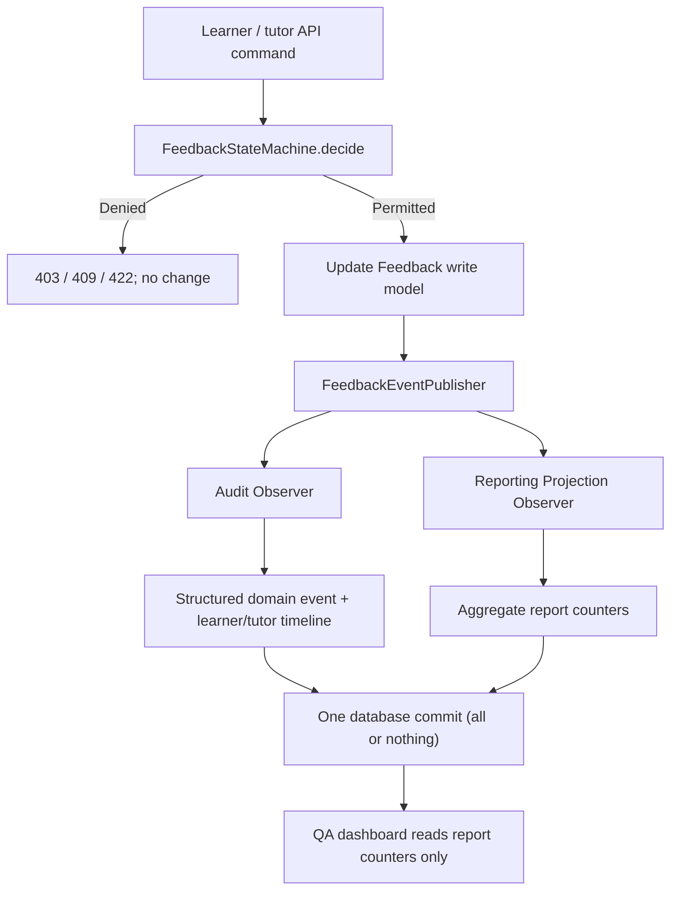

# Feedback Loop: State Machine, Observer and CQRS-style reporting

This refactor builds on the computing-pilot MVP. All feedback still comes from a tutor, never a language model.

## How they work together



### 1. State Machine — `mvp/workflow.py`

The same pure `FeedbackStateMachine.decide(...)` handles every requested
status transition. It accepts current state, desired state, authenticated
actor role, whether feedback requires action, and an optional progress note.
It returns an immutable `TransitionDecision`; the API **only persists**
approved decisions.

| Role | From | Allowed next |
| --- | --- | --- |
| Learner | Action required | In progress |
| Learner | In progress | Action required; Ready for review (explanation required) |
| Learner | Ready for review | In progress |
| Tutor | Ready for review | Closed (explicit tutor approval); In progress (return for changes) |
| Tutor | Information only | Closed (mark as reviewed) |
| Tutor | Closed | Action required (reopen) |
| Tutor | Action required | In progress |
| Tutor | In progress | Ready for review |
| Admin | Any | **No changes** |

**Why this pattern?** A `status` column alone cannot express who can
change it or which transitions are valid. Moving checks out of FastAPI into
one testable domain class makes it harder for a future mobile UI, Graph
adapter, or new API endpoint to bypass the **tutor-only closure** rule.

The service is deliberately framework-independent (no database or HTTP
imports). The adapter converts `TransitionRejected` into the appropriate
HTTP error.

### 2. Observer — `mvp/events.py`

The `FeedbackEventPublisher` receives an immutable, typed
`FeedbackChanged` event when a tutor creates a feedback item or when an
authorised actor moves it to another state.

Two observers subscribe:

- **Audit Observer:** `audit_feedback_change` in `mvp/api.py`; appends
  structured `mvp_domain_events` rows and existing readable timeline
  messages. A tutor closure event has `tutor_approved=true` and identifies
  the transition and acting tutor.
- **Report Projection Observer:** `ReportProjectionObserver` in
  `mvp/reporting.py`; increments/decrements aggregate counters when feedback
  is created or changes stage.

**Why Observer?** The lifecycle API only states *what happened*. Adding a
third observer later (for an opt-in College-approved reminder workflow) need
not change the state machine or every API handler. In this MVP observers run
**synchronously inside the same SQL transaction**. If reporting/auditing
fails, the feedback change cannot commit in isolation.

This is **not** a durable message queue, asynchronous Observer, or exactly-once
delivery system. For multi-service production integration, consider a
transactional outbox plus idempotent consumers and retries.

### 3. CQRS-style read model — `mvp/reporting.py`

**Command/write side:** the teacher/learner status endpoints validate changes
and persist `mvp_feedback`, plus associated events.

**Read/query side:** the QA reporting endpoint only reads
`mvp_report_counters`, keyed by:
- `total` and `actions_required`
- `status:ACTION_REQUIRED`, `status:IN_PROGRESS`, etc.
- `focus:<teacher-assigned-tag>`

For example, when a learner moves an item from Action required to In
progress, the projection observer subtracts one from
`status:ACTION_REQUIRED` and adds one to `status:IN_PROGRESS`.
The management report doesn't load all learner feedback records just to
count them. The **same API response shape** is preserved so the existing
professional QA dashboard keeps working.

**Why CQRS-style instead of full CQRS?** We split the model used for commands
and reporting queries *within the same database*. This lowers read costs and
limits exposure of personal student data in aggregate reporting without
introducing Kafka or extra infrastructure. The typed event log is useful
provenance, but the system is **not event-sourced**; Feedback remains the
authoritative state.

The projection is built once from existing feedback when the counters do
not yet exist. `AggregateReportReadModel.rebuild(session, Feedback)` is an
explicit recovery tool when counters need repair (run during a controlled
maintenance window, in a transaction). The QA endpoint **never** rebuilds
the projection per request.

## SOLID and privacy boundaries

- **Single Responsibility:** state-machine transitions, observer delivery,
  audit persistence and report queries have different jobs.
- **Open/Closed:** add observers for new side effects without modifying the
  transition rules.
- **Dependency Inversion:** `FeedbackEventPublisher` depends on a small
  `FeedbackObserver` protocol, not a particular audit/reporting class.
- **No student-facing automated judgment:** counters reflect only tutor
  labels and actual workflow actions, never predicted risk or AI analysis.
- **Role boundaries:** learner and tutor access stay scoped; aggregate admin
  endpoints never return individual learner notes or evidence.
- **Durability:** structured events and report changes are committed with
  the feedback update, or all roll back together.

## Testing and rollout

```bash
python -m pytest -q mvp/tests
node --check mvp/web/app.js
```

New tests cover the transition table, tutor-only closure, rejected operations
having no side effects, structured approval events, projection accuracy,
rollback on a broken projection, report reads not touching `mvp_feedback`,
and backfilling existing databases.

`Base.metadata.create_all` creates new tables for local development.
Use explicit migrations when deploying schema changes, and back up existing
local databases before updating them.

## Future extensions

1. A permissions/roster service independent of authentication.
2. An approved notification observer/outbox (no unapproved learner contact).
3. Date-aware read models for module completion and tutor response time,
   with small-group privacy safeguards and configurable reporting periods.
4. An administrator-authorised, logged projection rebuild command.
5. Production DB migrations, concurrency tests and end-to-end College SSO
   validation before handling real learner information.
